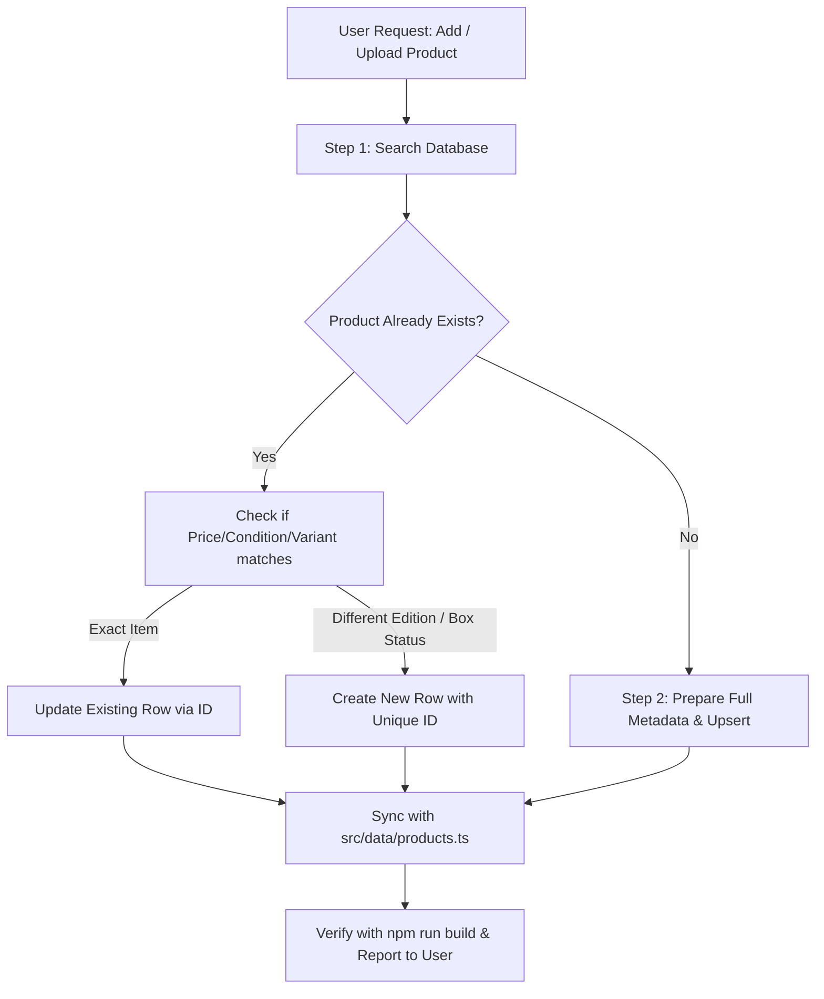

# DJN Tech — Database & Catalog Management Guide for Agents

> **Mandatory Reference for Future AI Agents & Developers**  
> Whenever a user asks to add, upload, edit, or reprice games or products in the database, follow the exact 2-step workflow below. Do not skip searching the database first.

---

## 1. Architecture Overview

DJN Tech uses a unified two-tier catalog architecture:
1. **Cloud Database (Primary)**: Supabase PostgreSQL (`public.products` table). This powers live prices, real-time stock, orders, and dynamic user updates.
2. **Local Codebase (Fallback & Build)**: `src/data/products.ts`. This powers offline mode, static SSR/build hydration, and fallback data.

### Supabase Connection
- **URL**: `https://rudqiwifokllmjpfcnbp.supabase.co`
- **Keys**: Stored securely in `.env.local` (`SUPABASE_SECRET_KEY` and `VITE_SUPABASE_ANON_KEY`).
- Reusable scripts in the `scripts/` directory automatically read `.env.local`.

---

## 2. Standard 2-Step Agent Workflow



---

## 3. Step 1: Search Database First

Before inserting any product, always search the database to check if the item or an alternative edition exists.

### Using the Search Script:
```bash
node scripts/search_catalog.mjs "<keyword or product name>"
# Or via npm script:
npm run db:search -- "<keyword or product name>"
```

### Examples:
```bash
# Search for PS4 Pro consoles:
node scripts/search_catalog.mjs "ps4 pro"

# Search for a game:
node scripts/search_catalog.mjs "fifa 20"

# Search for Nintendo Switch items:
node scripts/search_catalog.mjs "mario kart"
```

### How to Interpret Search Results:
- **Found exact match**: If the user asked to change price or stock, note the existing `id` (e.g. `product-1795065292560` or `fifa-20-ps4`) and use that ID to update it.
- **Found related variants (e.g. PS4 Pro Black exists, but user wants White)**: Keep the existing item untouched, and generate a new distinct ID for the new edition/color variant (e.g. `product-1795065292560` or `ps4-pro-1tb-white-preowned`).
- **Found 0 matches**: Safe to add as a brand-new item.

---

## 4. Step 2: Upsert Product to Database

Once you know the target ID and metadata, upsert the product into the database.

### Method A: Using CLI Flags
```bash
node scripts/upsert_product.mjs \
  --name "Super Mario Odyssey Preowned (Only Game Card)" \
  --price 3000 \
  --category "nintendo_games" \
  --platform "Nintendo Switch" \
  --condition "Pre-Owned Grade A+" \
  --badge "ONLY GAME CARD" \
  --image "https://images.igdb.com/igdb/image/upload/t_cover_big/co1mdf.jpg"
```

### Method B: From a JSON File or Direct Node Script
Create a quick `.mjs` script or pass inline JSON:
```javascript
import fs from 'fs';
import { createClient } from '@supabase/supabase-js';

const envContent = fs.readFileSync('.env.local', 'utf-8');
let secretKey = '';
let url = 'https://rudqiwifokllmjpfcnbp.supabase.co';
for (const line of envContent.split('\n')) {
  const [k, ...v] = line.split('=');
  if (k?.trim() === 'SUPABASE_SECRET_KEY') secretKey = v.join('=').trim();
}
const supabase = createClient(url, secretKey);

const product = {
  id: 'fifa-20-switch-card-preowned',
  name: 'FIFA 20 (Only Game Card)',
  subtitle: 'Authentic Game Cartridge (Only Game Card, No Box) · Tested & Working',
  category: 'nintendo_games',
  platform: 'Switch',
  condition: 'Pre-Owned Grade A+',
  mrp: 1999,
  price: 1200,
  discount_percent: 40,
  rating: 4.7,
  review_count: 22,
  in_stock: true,
  stock_count: 999,
  badge: 'ONLY GAME CARD',
  features: [
    'Original authentic Nintendo Switch game card (Game card only, box not included)',
    '100% verified working and optical laser/cartridge read tested',
    'Backed by DJN Tech Store testing guarantee'
  ],
  description: 'FIFA 20 for Nintendo Switch. Authentic pre-owned cartridge sold as Only Game Card (original box is not included). Tested and verified for smooth performance.',
  in_the_box: ['1x Nintendo Switch Game Cartridge (Only Game Card)'],
  warranty: 'DJN Tech Store Testing Guarantee',
  image_url: 'https://images.igdb.com/igdb/image/upload/t_cover_big/co1r76.jpg',
  updated_at: new Date().toISOString()
};

const { data, error } = await supabase.from('products').upsert(product, { onConflict: 'id' });
console.log('Upsert result:', data, error);
```

---

## 5. Crucial DJN Tech Catalog Rules & Schema Conventions

### A. Game Packaging: "Only Game Card" vs "With Box"
- **Only Game Card**:
  - Name: Must include `(Only Game Card)` in the title.
  - Badge: Must be `'ONLY GAME CARD'`.
  - Subtitle: `'Authentic Game Cartridge (Only Game Card, No Box) · Tested & Working'`
  - `in_the_box`: `['1x Authentic Game Cartridge (Only Game Card)']`
- **With Box (Standard)**:
  - Name: Standard game title (e.g. `Mario Kart 8 Deluxe Preowned`).
  - Badge: `'WITH BOX'` or `'NEW ARRIVAL'`.
  - `in_the_box`: `['1x Game Cartridge / Disc', '1x Original Retail Case Box']`

### B. Category Mapping
| Product Type | `category` Value | Valid Platforms |
| :--- | :--- | :--- |
| **Consoles** (PS5, PS4, Xbox, Switch) | `'consoles'` | `'PS5'`, `'PS4'`, `'Xbox'`, `'Switch'` |
| **Controllers** (DualSense, DualShock, etc.) | `'controllers'` | `'PS5'`, `'PS4'`, `'Xbox'`, `'Universal'` |
| **PlayStation & Xbox Games** | `'preowned_games'` | `'PS5'`, `'PS4'`, `'Xbox'` |
| **Nintendo Switch Games** | `'nintendo_games'` | `'Switch'` (or `'Nintendo Switch'`) |
| **Accessories** (Cables, Docks, Headsets) | `'accessories'` | `'Universal'`, `'PS5'`, `'PS4'` |

### C. Condition Formatting
- Use standard strings:
  - `'Pre-Owned Grade A+'` (standard pre-owned)
  - `'Brand New Sealed'` (brand-new retail units)

### D. Stock Counts
- In DJN Tech, active store products must always have:
  - `in_stock: true`
  - `stock_count: 999` (to prevent automated out-of-stock lockouts)

### E. Standard Warranty Strings
- **Consoles & Controllers (PlayStation, Xbox - except Nintendo series)**:
  `'1 Month Shop Warranty (Warranty does not cover physical and liquid damage)'`
- **Nintendo Series Consoles**:
  `'Testing Warranty (Warranty does not cover physical and liquid damage)'`
- **Pre-owned Games**:
  `'1 Day Testing Warranty'`
- **Brand New Items**:
  `'1 Year Official Brand Warranty'`

---

## 6. Step 3: Local Codebase Synchronization (`src/data/products.ts`)

After upserting into the database:
1. Open [src/data/products.ts](file:///d:/Downloads/djn-tech---consoles,-controllers-&-pre-owned-games-store/src/data/products.ts).
2. Ensure the product is also present in the `PRODUCTS` array with camelCase properties (`imageUrl`, `discountPercent`, `stockCount`, `inStock`, `inTheBox`).
3. Run `npm run build` to verify there are zero TypeScript syntax errors.
4. Push changes to GitHub remotes (`origin/main` and `personal/main`) so Cloudflare deploys the updated bundle.
